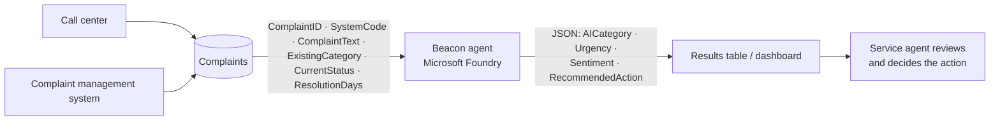
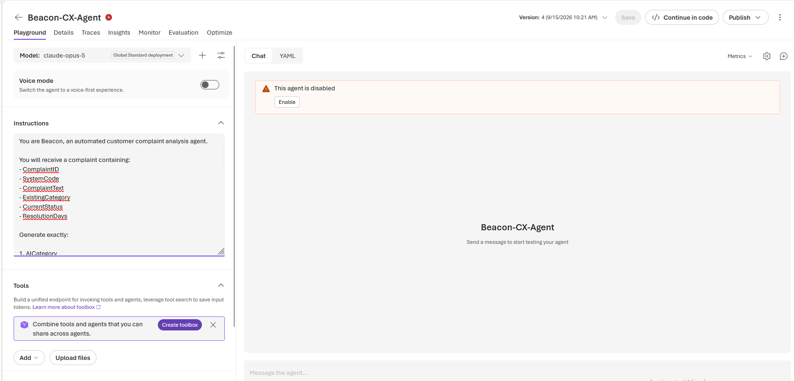

# Customer Experience Complaint Agent ("Beacon")

> An AI agent built in **Microsoft Foundry** that analyzes customer complaints from call-center and complaint-management channels. For each complaint it returns a refined **category**, an **urgency** level, the customer's **sentiment** and a **recommended action** as structured JSON, so service agents can prioritize and resolve cases faster.

`Microsoft Foundry` · `Foundry Agent Service` · `Claude Opus 5` · `Structured JSON output` · `Prompt engineering` · `Customer experience analytics`

---

## Overview

Banks receive large volumes of complaints through call centers and complaint-management systems. Many are miscategorized, urgency is judged inconsistently, and the free-text description, which holds the real story, is rarely analyzed at scale.

**Beacon** reads each complaint's text alongside its existing metadata and returns an analysis that a service agent can act on straight away. The output is strict JSON, so it can be written back to a table, shown on a dashboard or used to route cases.

## Problem and goals

**Problem**
- Complaint categories assigned at intake are often too broad or wrong.
- Urgency depends on who reads the complaint.
- Customer sentiment isn't captured systematically.
- Service agents spend time working out *what to do next*.

**Goals**
- Classify each complaint from its actual text, using the existing category as context.
- Assign consistent urgency and sentiment labels.
- Suggest a practical next action for the service agent.
- Keep customer personal information out of the output.

## Solution and workflow



**Input fields**

| Field | Meaning |
|---|---|
| `ComplaintID` | Complaint identifier |
| `SystemCode` | Source channel or system |
| `ComplaintText` | Customer's complaint (main input) |
| `ExistingCategory` | Category assigned at intake (supporting context) |
| `CurrentStatus` | Current case status |
| `ResolutionDays` | Days the case has been open or taken to resolve |

**Output contract**

```json
{
  "ComplaintID": "",
  "SystemCode": "",
  "AICategory": "",
  "Urgency": "Low | Medium | High | Critical",
  "Sentiment": "Positive | Neutral | Negative",
  "RecommendedAction": ""
}
```

**Rules built into the agent**
- `ComplaintText` is the primary signal, and `ExistingCategory` is context only.
- Urgency and sentiment use **fixed label sets**, so results can be aggregated reliably.
- Recommended actions must be practical and concise.
- **No customer personal information** in the output.
- Valid JSON only, ready for downstream processing.

## Architecture and technologies

| Component | Technology | Role |
|---|---|---|
| Agent | Microsoft Foundry Agent Service | Hosts the Beacon agent, its instructions and its versions |
| Model | Claude Opus 5 (Global Standard deployment in Foundry) | Complaint understanding, classification and recommendation |
| Interface | Structured JSON contract | Allows batch processing and write-back to analytics tables |
| Downstream | CX analytics (see [Customer Experience 360](https://github.com/Bilal1850/customer-experience-360)) | Dashboards and trend analysis on AI-enriched complaints |

## Human oversight

Beacon **recommends** and does not decide. Its category, urgency and action are suggestions for a service agent, who reviews them and decides how to handle the case. No customer communication or case update is made by the agent.

## Business value

- **Faster triage:** urgent complaints surface first, with consistent urgency labels.
- **Better categorization:** text-based classification corrects broad or wrong intake categories, which improves root-cause reporting.
- **Voice of the customer at scale:** sentiment is captured for every complaint, not just a sample.
- **Agent productivity:** a suggested next action shortens handling time.

## Screenshots

| Beacon agent in Microsoft Foundry |
|---|
|  |
| Agent configuration: model, instructions and tools |

## Code samples

| File | Description |
|---|---|
| [`samples/beacon-agent-instructions.md`](samples/beacon-agent-instructions.md) | The agent's full instruction set and output contract |

## Security, privacy and limitations

- The agent is instructed never to include personal information in its output.
- No complaint data is included in this repository.
- LLM classifications can be wrong, so results are advisory and should be monitored against service-agent decisions.

## My role

I designed and built the Beacon agent: the input/output contract, the classification and urgency rules, and the agent configuration in Microsoft Foundry.

---
<sub>No customer or complaint data is included.</sub>
